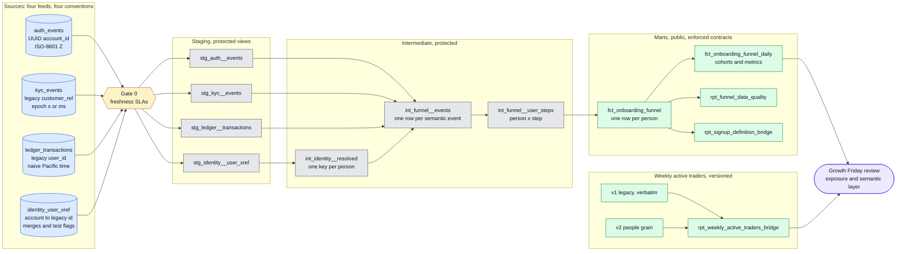
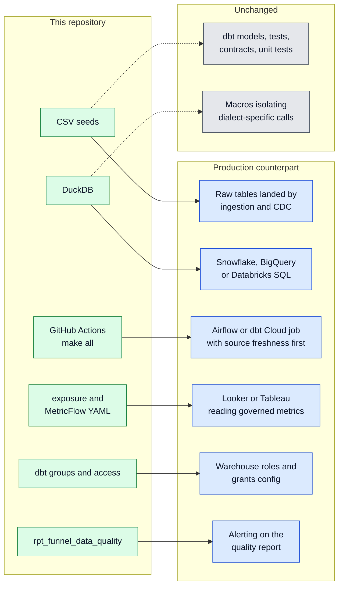

# Coinbase Onboarding Funnel — dbt reference implementation

[](https://github.com/ajaygutha1/coinbase-analytics-engineering-bounty/actions/workflows/dbt.yml)


A runnable answer to the Coinbase *Insights to Impact* Analytics Engineer bounty (2026). The
challenge ships **no data**, so this repo ships **synthetic seed data with every trap planted on
purpose** and a dbt project (DuckDB) whose tests prove each trap is handled. It builds in under ten
seconds and needs nothing but Python. Nothing here claims to reproduce Coinbase production schemas;
the source shapes are stated assumptions.

> **The thread through all four exercises:** they are one data-contract problem at different
> layers. Exercise 1 asks for one person grain, one identity key, one time-zone rule and one metric
> definition. Exercise 2 (52K / 45K / 57K) is what happens when "signup" and "day" drift between
> systems. Exercise 3 comma-joins `trades` to `devices` on `user_id` and fans out. Exercise 4
> (41% vs 34%) is that same fan-out surfacing in a dashboard. The DAG below is built so the
> Exercise 4 conversation cannot recur.

| Exercise | Where it is answered in this repo |
|---|---|
| 1 · Design the data model | `models/` (staging → identity → events → person × step → person mart), `models/marts/_marts.yml` contract + metrics, [ADRs 0001–0006](docs/adr/) |
| 2 · The data doesn't add up | `scripts/ex2_diagnose.py` (blind diagnostic on any three CSVs), `scripts/ex2_make_fixtures.py`, `tests_py/`, `rpt_signup_definition_bridge` |
| 3 · The inherited pipeline | `analyses/ex3_legacy_weekly_active_traders.sql` (verbatim, annotated), `…_refactored…`, `…_parity_query.sql`, `assert_ex3_refactor_parity_by_country`, [ADR 0008](docs/adr/0008-characterization-before-refactor.md) |
| 4 · Your number is "wrong" | `fct_weekly_active_traders` v1 / v2, `rpt_weekly_active_traders_bridge`, `rpt_ex3_trade_walk`, `rpt_ex4_alternative_explanations`, `scripts/ex4_fanout_bridge.py`, [ADR 0007](docs/adr/0007-versioned-metrics.md) |

## Review this repo in 10 minutes

1. **The deliverable** — [`models/marts/fct_onboarding_funnel.sql`](models/marts/fct_onboarding_funnel.sql) (one row per person, two funnel readings) and its contract in [`_marts.yml`](models/marts/_marts.yml).
2. **Where the judgment lives** — [`int_funnel__events.sql`](models/intermediate/int_funnel__events.sql): the on-chain natural key, terminal-success rule, LEFT joins to identity, ingestion-time watermark.
3. **Proof it handles the mess** — [`seeds/seeds.yml`](seeds/seeds.yml) lists every planted trap; [`tests/`](tests/) and [`_unit_tests.yml`](models/staging/_unit_tests.yml) catch each one. `make build` runs them in under ten seconds.
4. **Exercise 2** — run [`scripts/ex2_diagnose.py`](scripts/ex2_diagnose.py) on the generated CSVs and read [`docs/EXERCISE2_PM_MEMO.md`](docs/EXERCISE2_PM_MEMO.md), the message the PM would get.
5. **Exercise 3** — [`analyses/ex3_legacy_weekly_active_traders.sql`](analyses/ex3_legacy_weekly_active_traders.sql) (verbatim, seven flags) → [`…_refactored…`](analyses/ex3_refactored_weekly_active_traders.sql) → [`…_parity_query.sql`](analyses/ex3_parity_query.sql).
6. **Exercise 4** — [`rpt_weekly_active_traders_bridge`](models/weekly/rpt_weekly_active_traders_bridge.sql) and [`docs/EXERCISE4_TALK_TRACK.md`](docs/EXERCISE4_TALK_TRACK.md), the hallway conversation and the one slide.
7. **Why, not just what** — [`docs/adr/`](docs/adr/) (eight decisions with the rejected alternative) and [`docs/BUILD_VERIFICATION_REVIEW.md`](docs/BUILD_VERIFICATION_REVIEW.md) (what running it found, including the bug that dropped every fiat deposit).

---

## Contents

1. [Quick start](#quick-start)
2. [Architecture](#architecture)
3. [Structural decisions and trade-offs](#structural-decisions-and-trade-offs)
4. [Metric definitions](#metric-definitions)
5. [Data quality: planted cases and the tests that catch them](#data-quality-planted-cases-and-the-tests-that-catch-them)
6. [Incremental strategy](#incremental-strategy)
7. [How the model answers Exercises 2–4](#how-the-model-answers-exercises-24)
8. [Engineering practices](#engineering-practices)
9. [Questions a reviewer might ask](#questions-a-reviewer-might-ask)
10. [Repository map](#repository-map)
11. [Production mapping](#production-mapping)
12. [Configuration](#configuration)
13. [Known limits](#known-limits)

---

## Quick start

Requires Python 3.12. No warehouse, no dbt packages, no credentials: DuckDB runs in-process.

```bash
python3 -m venv .venv && source .venv/bin/activate
pip install -r requirements.txt            # dbt-core, dbt-duckdb, duckdb (pinned)
export DBT_PROFILES_DIR=.

dbt seed                                   # 10 synthetic fixtures
dbt build --exclude resource_type:seed     # 18 models, 8 unit tests, 214 data tests, enforced contracts on every mart
dbt build --exclude resource_type:seed     # again: exercises the incremental merge / watermark paths

python scripts/ex2_make_fixtures.py        # builds the 52K / 45K / 57K day with known causes
python scripts/ex2_reconcile_signups.py    # runs the BLIND diagnostic and asserts it recovers them; residual 0
python scripts/ex4_fanout_bridge.py        # 41% (trades x devices) vs 34% (people); gap = 7 fan-out rows
python scripts/validate_funnel_fixture.py  # independent Python oracle for every planted case

make lint test replay                      # ruff + sqlfluff + static checks; pytest; late-arrival incremental replay
dbt docs generate && dbt docs serve        # column-level docs for every model
```

Expected: `Done. PASS=238 WARN=2 ERROR=0`. Both warnings are intentional and come from the same
planted row, a KYC case whose `customer_ref` (9999) matches no person. It is flagged, counted and
kept upstream, never dropped silently.

To point the staging layer at real warehouse tables instead of seeds, declare them in
[`models/staging/_sources.yml`](models/staging/_sources.yml) and run with
`--vars '{use_seed_sources: false}'`. No model SQL changes; CI compiles that mode on every push.

---

## Architecture

### System overview

Four feeds with four identifier and timestamp conventions go in; one person-level table and one
governed metric layer come out. Each layer has one job and its own gates.



Seven more diagrams explain the rest, in [docs/ARCHITECTURE.md](docs/ARCHITECTURE.md):

| Diagram | Question it answers |
|---|---|
| [Quality gates by layer](docs/ARCHITECTURE.md#2-quality-gates-by-layer) | Where does a bad row get stopped? |
| [Life of an event](docs/ARCHITECTURE.md#3-life-of-an-event) | What happens to one messy row? |
| [Identity resolution](docs/ARCHITECTURE.md#4-identity-resolution) | How does one person get one key? |
| [Incremental and late arrivals](docs/ARCHITECTURE.md#5-incremental-processing-and-late-arrivals) | What happens when data arrives late? |
| [Exercise map and the fan-out thread](docs/ARCHITECTURE.md#6-exercise-map-and-the-fan-out-thread) | How do the four exercises connect? |
| [CI pipeline](docs/ARCHITECTURE.md#7-ci-pipeline) | What proves it works on every push? |
| [Production mapping](docs/ARCHITECTURE.md#8-production-mapping) | How would it run on a production stack? |

The model-level DAG generated from the dbt manifest is [docs/LINEAGE.md](docs/LINEAGE.md).

### Layer rules

| Layer | Materialization · access | Grain | Allowed | Never |
|---|---|---|---|---|
| `stg_` | view · protected | same as source | rename, cast to UTC, canonicalize ids, decode codes, drop **exact** re-deliveries | joins, business logic, filtering rows |
| `int_` | view / incremental · protected | event, then person × step | identity resolution, union, semantic dedupe, choosing the first success | anything a PM would query directly |
| `fct_` / `rpt_` | table, enforced contract, incremental merge · public | one row per person, then aggregates | pivot, durations, flags, cohort dates | recomputing logic that belongs upstream |

`protected` means a model outside the `growth_analytics` group cannot `ref()` it: a notebook or a
dashboard cannot quietly build on an intermediate table and inherit its exclusions.

### Naming conventions that carry meaning

- Timestamps end in `_at_utc`. Dates end in `_pt` (reporting zone) or `_utc`. A column without a suffix is never a time.
- Booleans start with `is_`, `has_` or `reached_`. Counts start with `n_` or `users_`.
- `user_sk` is the only person key that leaves the intermediate layer. `account_id` and `legacy_user_id` survive only as debugging attributes.
- `stg_<source>__<table>`; the funnel pipeline is `int_funnel__*` so `dbt ls --select int_funnel__*` selects it whole.

### Assumed inputs

| Feed | Owns | Identifier | Timestamp encoding | Nastiness it brings |
|---|---|---|---|---|
| `auth_events` | account created, email verified | UUID `account_id` (mixed case) | ISO-8601 `Z` | exact re-deliveries |
| `kyc_events` | identity verification history | numeric legacy `customer_ref` (zero-padded) | epoch **ms, sometimes s** | retries, revocations, unresolved ids |
| `ledger_transactions` | first deposit, first trade | numeric legacy `user_id` | **naive Pacific** wall-clock | re-orgs, batched logs, mints, dust, uint256 amounts |
| `identity_user_xref` | account ↔ legacy id | both | ISO-8601 `Z` | merges, test accounts |

Column-level assumptions, with the specific problem and normalization for each column, are in
[`models/staging/_sources.yml`](models/staging/_sources.yml) and [`seeds/seeds.yml`](seeds/seeds.yml).

---

## Structural decisions and trade-offs

Each of these has a full record in [`docs/adr/`](docs/adr/).

| Decision | Choice | Why this and not the obvious alternative |
|---|---|---|
| **Grain of the deliverable** ([ADR 0001](docs/adr/0001-one-row-per-person.md)) | one row per person (`user_sk`) | A PM asks "how many users reached KYC" and gets it with `count(*)`. Event-level detail lives in `int_funnel__events`; the mart never re-derives it. |
| **Person key** | `md5(canonical_account_id)` after following merge pointers | `account_id` double-counts re-registrations; email changes; `device_id` is shared. Merges collapse to the survivor and keep the **older** signup. |
| **On-chain deposit key** ([ADR 0002](docs/adr/0002-onchain-natural-key.md)) | `chain_id : tx_hash : log_index` | `tx_hash` alone collides across chains and inside batched transfers, and a re-org re-emits it. With the natural key, a `settled → reversed` restatement **updates** the event instead of adding a second deposit. |
| **Null vs sentinel address** | `null` is legitimate (fiat / internal); `0x000…0` becomes `is_from_zero_address` + null | Never confuse "no chain" with "unknown counterparty". The flag is `coalesce`d to two values because a NULL here once silently dropped every fiat deposit ([verification review](docs/BUILD_VERIFICATION_REVIEW.md)). |
| **Time** ([ADR 0003](docs/adr/0003-store-utc-report-pacific.md)) | store UTC (`_at_utc`), report Pacific (`_pt`); one macro per encoding | The Friday review is in PT; 17:00–24:00 PT is the next UTC day. The ledger's naive timestamps go through a **named var**; both DST edge cases are flagged, not guessed. |
| **Step advancement** | first **terminal success** only | Attempts, pending states and rejections are counted (`n_negative_events`) but never advance a step. A later KYC revocation is a flag. |
| **Out-of-order / missing events** ([ADR 0004](docs/adr/0004-observed-and-strict-funnel.md)) | two readings, `observed` and `strict`, plus named flags | Strict is brittle to a late webhook; observed can overstate. Shipping both makes the disagreement a measurable column (`rpt_funnel_data_quality`). Nothing is imputed, nobody is dropped. |
| **Dust and mints** | `minimum_deposit_usd` var (default `$1`) on the parsed USD notional | Policy belongs in config a PM can change in a one-line PR. An unparseable notional can never satisfy the threshold. |
| **High-precision amounts** | keep the raw string **and** a `try_cast` `DECIMAL(38,18)` / `(38,8)`; overflow is a flag | Base-unit integers can exceed 38 digits. Floating point rounds silently and a hard cast crashes the build; a flag does neither. |
| **Exclusions** ([ADR 0006](docs/adr/0006-flags-not-filters.md)) | flags in intermediate, filters only in marts | Test accounts and unresolved identities stay auditable with one `GROUP BY`; a warn-level test counts them. |
| **Joins to identity** | always `LEFT JOIN` | An inner join turns an identity-team backlog into a fake conversion drop. |
| **Contracts and access** | enforced contracts on every mart; staging/intermediate `protected`, marts `public`, one owning group | An upstream type change fails the build, not the dashboard; nobody can build on an intermediate table by accident. |
| **Metric definitions** ([ADR 0007](docs/adr/0007-versioned-metrics.md)) | semantic model on the daily mart + **model versions** for weekly active traders | You cannot have a 41% and a 34% if there is only one definition. Versioning turns Exercise 4 into a deprecation date. |
| **Refactoring inherited SQL** ([ADR 0008](docs/adr/0008-characterization-before-refactor.md)) | keep the legacy query verbatim as a characterization baseline; prove parity per country | AI proposes; the parity query verifies. Its claim of equivalence is a hypothesis, not evidence. |
| **Dependencies** | none (no dbt packages) | The time spine uses DuckDB `generate_series`; CI installs three pinned wheels and runs. |

---

## Metric definitions

Defined once, in YAML, on `fct_onboarding_funnel_daily` ([`models/marts/_marts.yml`](models/marts/_marts.yml)). A dashboard reads them; it cannot redefine them.

| Metric | Definition | Grain |
|---|---|---|
| `daily_signups` | Distinct canonical, non-test people whose **first `account_created` success** falls on the **Pacific calendar day**. Merges collapsed to one person. | person × PT day |
| `identity_verified_observed` | People in the cohort who were ever KYC approved. | person |
| `first_deposits_observed` | People in the cohort who ever made a settled deposit ≥ `minimum_deposit_usd` from a non-zero address. | person |
| `first_trades_observed` | People in the cohort who ever made a filled trade, regardless of order. | person |
| `first_trades_strict` | People who traded **after** depositing, after KYC, after email, after signup, in order. | person |
| `signup_to_trade_conversion_observed` | `first_trades_observed / daily_signups`. **Default conversion metric.** | ratio |
| `signup_to_trade_conversion_strict` | `first_trades_strict / daily_signups`. For sequence-sensitive analysis. | ratio |
| `signup_to_kyc_conversion` | `identity_verified_observed / daily_signups`. | ratio |

**Weekly active traders** (`fct_weekly_active_traders`, versioned; the Exercise 4 metric):

| Version | Definition | On the fixture | Status |
|---|---|---|---|
| `v1` | the inherited query's core logic **verbatim**: completed-trade rows after the `users, trades, devices` comma join, ÷ weekly active users | 41 / 100 = **41%** | deprecated `2026-11-13` |
| `v2` | **distinct people** with a completed trade (status decoded) in the PT week who have ≥ 1 active device (`EXISTS`), ÷ weekly active users | 34 / 100 = **34%** | current, `latest_version: 2` |

`rpt_weekly_active_traders_bridge` decomposes the gap per country: 41 rows − 7 fan-out rows (traders
with a second active device) = 34 people. It also surfaces two side effects of the legacy query that
are *not* the fan-out: its own `COUNT(DISTINCT)` is 36 because the status filter sits only inside the
`SUM` (two failed-only users), and one trader with no active device is dropped by the inner join in
both definitions. `bridge_closes` is tested to be true on every row.

**Funnel readings** on `fct_onboarding_funnel`:

```sql
furthest_step_observed = highest terminal success ever seen                    -- 0..5, any order
furthest_step_strict   = walk signup→email→KYC→deposit→trade; stop at the       -- 0..5, always <= observed
                         first step that is missing or earlier than its predecessor
has_sequence_anomaly   = observed <> strict
data_quality_flags     = 'trade_before_deposit|kyc_revoked_after_approval|late_arriving_event|...'
```

---

## Data quality: planted cases and the tests that catch them

Every row in `seeds/` is there to break something specific. Each has a model decision and a test.

| Person / row | What is wrong | Observed | Strict | Flag | Test |
|---|---|---|---|---|---|
| Alice | on-chain deposit **re-org'd** (`settled → reversed` under the same `chain:hash:log_index`), replaced by a new tx | 5 | 5 | none | `assert_reorg_latest_restatement_wins`, `assert_reorg_replacement_is_first_deposit` |
| Bob | KYC rejected then approved; `account_id` arrived lowercase once | 5 | 5 | none; `kyc_negative_events = 1` | `assert_bob_kyc_retry_audited` |
| Carol | one tx with **two transfer logs** plus an exact re-delivery; signed up 06:58Z | 4 | 4 | none; 2 deposits not 3; cohort day Sep 13 PT | `assert_carol_batched_tx_counts_two_deposits`, unit test `funnel_pacific_boundary_…` |
| Frank | first deposit is a **$0 mint from the zero address** | 4 | 4 | none; `first_deposit_usd = 25` | `assert_zero_mint_does_not_advance`, `assert_zero_address_normalized` |
| Grace | first **trade settled before first deposit** | 5 | 4 | `trade_before_deposit` | `assert_grace_trade_before_deposit_flagged`, unit test `funnel_trade_before_deposit_…` |
| Heidi | KYC approved, then **revoked** a day later | 5 | 5 | `kyc_revoked_after_approval` | `assert_heidi_revocation_retained_as_flag` |
| Ivan | KYC stuck in pending | 2 | 2 | none; correctly stalled | monotonic / strict tests |
| Judy | abandoned `ACC-0010`, re-registered as `ACC-0011`, later **merged**; ledger events arrived 2 days late | 5 | 5 | `late_arriving_event`; one row, signup from the older account | `assert_judy_merge_one_person`, `assert_late_arrival_is_flagged` |
| QA bot | test account fires real events | excluded | excluded | `is_test_account` upstream | `assert_test_accounts_not_in_mart` |
| `customer_ref 9999` | KYC case with no crosswalk entry | excluded | excluded | `is_identity_unresolved` | `assert_unresolved_identities_warn` (warn), `assert_unresolved_id_not_in_mart` |
| `k4` | epoch **seconds** among milliseconds | — | — | — | unit test `kyc_epoch_seconds_and_milliseconds_normalize`, `assert_no_future_events` |
| fiat rows | `from_address` is null | — | — | must count | `assert_settled_deposits_above_threshold_are_successes`, `assert_terminal_success_is_never_null`, unit test with a null-address row |
| unit fixtures | 39-digit amount; DST fall-back hour; DST spring-forward gap | — | — | precision / DST flags | unit tests in `models/staging/_unit_tests.yml` |
| Exercise 3 fixture | 7 multi-device traders, 2 failed-only users, 1 trader with no active device, 1 PT-week boundary trade, 2 users who moved country | — | — | — | `assert_legacy_fanout_gap_exact`, `assert_ex3_refactor_parity_by_country` |

### Test layers

| Layer | What it proves | Count |
|---|---|---|
| Unit tests (fixture rows, no warehouse data) | dedupe direction, epoch decoding, precision overflow, zero-address sentinel, both DST edges, observed-vs-strict walk, Pacific boundary, multi-hop and dangling merges flagged | 8 |
| Schema tests (`unique`, `not_null`, `accepted_values`, `relationships`) | each model has the grain it claims; enums are closed; flags are two-valued; the crosswalk cannot fan out | 178 |
| Singular tests (business invariants) | funnel monotonic; **mart reconciles to event layer** (catches silent row loss, which uniqueness cannot); no future events; PT/UTC never drift > 1 day; natural keys unique after semantic dedupe; legacy output frozen (characterization); per-country refactor parity; every planted case | 36 |
| Enforced contracts | column names and types frozen on every mart | 6 |
| Warn-level tests | known-imperfect inputs do not block the deck | 2 |
| Python unit tests (`pytest`) | each check in the Exercise 2 diagnostic, including a nonzero residual for an unexplained user | 6 |
| Late-arrival replay | the incremental path processes a late event and recomputes only the touched person | 1 |
| Source freshness SLAs | a stale feed is a pipeline incident, not a Growth story (declared; runs against production sources) | 4 |

---

## Incremental strategy

The person table is small and the event tables are large, so: touch the big tables once, incrementally, and rebuild the small table only for people who changed. Full record: [ADR 0005](docs/adr/0005-ingestion-time-watermark.md).

| Model | Strategy | Why |
|---|---|---|
| `int_funnel__events` | `merge` on `event_key`; watermark = `max(ingested_at_utc)` − `incremental_lookback_days` | **Watermark on ingestion time, never event time.** A Monday event that arrives Thursday is inside Thursday's window. |
| identity changes | rows for any id whose crosswalk changed inside the lookback are re-pulled regardless of ingestion time | A merge must re-key history, not just new events. |
| `int_funnel__user_steps` | `delete+insert` on `(user_sk, funnel_step)` for touched people; post-hook deletes orphaned keys | One aggregation per touched person; a merged-away key does not linger. |
| `fct_onboarding_funnel` | `merge` on `user_sk` for touched people; contract enforced; post-hook removes people with no signup | A pivot of the previous model; seconds, not hours. |
| daily, bridge, data-quality, weekly | full refresh | Cheap aggregates; a full rebuild guarantees restated cohorts are correct. |

Dedupe happens **before** the union (each source at its own grain in staging); the union only handles cross-row semantics (the on-chain natural key). Pivot happens **last**, so a sixth funnel step is one entry in `macros/funnel_steps.sql` and one column.

---

## How the model answers Exercises 2–4

**Exercise 2 — 52K / 45K / 57K.** The challenge asks for a script that *programmatically identifies where the systems diverge, starting with duplicate user IDs in System C*. [`scripts/ex2_diagnose.py`](scripts/ex2_diagnose.py) takes any three CSV extracts, detects the id / timestamp / email columns, and works in the order you would with two hours on the clock, without being told a cause:

1. **Duplicates in System C, three flavours** because each has a different fix: exact duplicate rows (re-deliveries), ids that collapse after trim / case / zero-padding canonicalization, and ids with genuinely different timestamps.
2. **Sets, not counts.** Pairwise intersections and the users only one system has. A count can match by coincidence; a set difference names the users.
3. **UTC hour-of-day histogram** of the one-system-only users. A cliff at 07:00Z is Pacific midnight, not data loss.
4. **Population**: QA accounts by email domain or id pattern.
5. **Definition**: a system whose timestamp column is `verified_at` is counting a different event.
6. **Bridge and residual**, each line labelled exact or ESTIMATE.

`scripts/ex2_make_fixtures.py` builds a day where the three numbers are true with known causes, and `scripts/ex2_reconcile_signups.py` asserts the diagnostic recovers every one of them blind:

```text
System C raw rows                                      57,000   exact
- exact duplicate rows in System C                      4,000   exact
- case/padding variant ids in System C                  1,000   exact
= System C distinct canonical ids                      52,000   exact   (= System A)
- test / QA accounts                                    1,000   exact
- previous Pacific day (UTC-day spillover)              4,500   exact
+ Pacific evening after 24:00Z                          3,507   ESTIMATE (3,156 observed verified in B, grossed up at 90%)
= distinct production people on the Pacific day        50,007   ← recommended
- signed up but not in System B (verified-only)         5,004
= System B distinct ids                                45,003   exact
Residual                                                    0
```

The same bridge is reproduced in SQL over the raw CSVs ([`analyses/ex2_reconciliation_in_sql.sql`](analyses/ex2_reconciliation_in_sql.sql)); CI asserts Python and SQL agree line for line. What the PM would receive is in [`docs/EXERCISE2_PM_MEMO.md`](docs/EXERCISE2_PM_MEMO.md). In dbt the bridge is a permanent model, `rpt_signup_definition_bridge`, so the next discrepancy is a query.

**Exercise 3 — the inherited pipeline.** The snippet from the challenge is kept **verbatim** (and its per-country output frozen as a characterization test) in [`analyses/ex3_legacy_weekly_active_traders.sql`](analyses/ex3_legacy_weekly_active_traders.sql) with seven flags annotated: F1 comma-join fan-out on devices, F2 hard-coded timezone-less week, F3 magic status codes, F4 inner join drops device-less traders, F5 today's country not country-as-of-week, F6 status filter only inside the `SUM` so `active_traders` counts failed-only users, F7 no tests / no owner. [`…_refactored…`](analyses/ex3_refactored_weekly_active_traders.sql) fixes each in a named CTE and returns `country_as_of_week` next to the parity column. [`…_parity_query.sql`](analyses/ex3_parity_query.sql) proves, per country, that the refactor differs from the legacy output only by the failed-only users and the device multiplier; `assert_ex3_refactor_parity_by_country` pins it. AI is used to explain and propose; the parity query verifies.

**Exercise 4 — 41% vs 34%.** Two implementations of the same idea at different grains. `models/weekly/` ships both as versions of one model, `rpt_weekly_active_traders_bridge` is the one slide, and `scripts/ex4_fanout_bridge.py` reproduces it in twenty lines of Python. The recommendation is a dual-run, not a surprise: present v1 labelled as the legacy definition, add the bridge, adopt v2 next review, restate history under v2, name an owner, deprecate v1 on the date in the YAML. The new table is never edited to match the old number. The conversation itself, and the slide, are in [`docs/EXERCISE4_TALK_TRACK.md`](docs/EXERCISE4_TALK_TRACK.md).

---

## Engineering practices

- **CI** ([`.github/workflows/dbt.yml`](.github/workflows/dbt.yml)): a `lint` job (ruff, sqlfluff, static project checks, pytest) gates a `build` job (seed → full-refresh build → incremental build → production-source compile → analyses compile → Exercise 2 proofs in Python and SQL → Exercise 4 proof → fixture oracle → **late-arrival replay** → exposure lineage → docs + lineage freshness check → artifact upload).
- **Late-arrival replay** ([`scripts/incremental_replay.py`](scripts/incremental_replay.py)): injects a KYC approval whose event time is inside the fixture week but whose ingestion time is now, runs the ordinary incremental build, and asserts that exactly one person's row was recomputed, that person moved from step 2 to 3, and the cohort's KYC count rose by one. A second `dbt build` on unchanged data proves nothing; this does.
- **Characterization test for Exercise 3**: the verbatim legacy query is materialized (`rpt_ex3_legacy_characterization`) and compared per country to its output frozen before refactoring (`seeds/ex3_legacy_expected.csv`). If the baseline moves, every parity claim is void, and the build says so.
- **Contracts, groups, access**: every mart has an enforced contract; all models belong to `growth_analytics`; staging and intermediate are `protected`.
- **Lineage from the manifest**: `scripts/render_lineage.py` writes [`docs/LINEAGE.md`](docs/LINEAGE.md); CI fails if it is stale.
- **ADRs** in [`docs/adr/`](docs/adr/) for the eight decisions that shape the project.
- **Reviews**: [`docs/FAILURE_MODE_REVIEW.md`](docs/FAILURE_MODE_REVIEW.md) (adversarial desk review of failure modes) and [`docs/BUILD_VERIFICATION_REVIEW.md`](docs/BUILD_VERIFICATION_REVIEW.md) (what actually running it found, including a NULL-handling bug that had silently dropped every fiat deposit, and the fidelity pass against the challenge text).
- **Tooling**: `Makefile` targets mirror CI; `.pre-commit-config.yaml`; `pyproject.toml` for ruff/pytest; `.sqlfluff` with the verbatim legacy file ignored on purpose.
- **Docs site**: `dbt docs generate` locally, or the manual `publish-dbt-docs` workflow to GitHub Pages.

---

## Questions a reviewer might ask

**Why `md5(canonical_account_id)` instead of an integer surrogate or the account id itself?**
The mart needs a stable key that survives merges and is the same on every rebuild, in every warehouse, without a sequence. A hash of the canonical account is deterministic and portable; the account id itself is kept as an attribute for debugging. An integer surrogate would need a persistent mapping table, which is exactly the kind of state that drifts between environments.

**Why are intermediate models views? At Coinbase scale that is a full scan.**
On the fixture, views keep the DAG transparent. The two models that would be expensive, `int_funnel__events` and `int_funnel__user_steps`, are already incremental with an ingestion-time watermark, and the mart merges only touched people. `int_identity__resolved` should become a table when the crosswalk is large. Materialization is a config change, not a rewrite.

**Why not impute a deposit when a trade exists? A trade implies funding.**
Because a manufactured timestamp is indistinguishable from a real one downstream. Grace's case is kept as observed 5 / strict 4 with a named flag, so a PM can choose the reading and an engineer can see how many such users exist (`rpt_funnel_data_quality`).

**Your Exercise 2 bridge closes with residual 0. Real data never does.**
Correct, and the diagnostic is built to say so: users that only one system has and that no identified cause explains are listed by id and reported as a nonzero residual (see `test_unexplained_users_show_up_as_nonzero_residual`). The fixture is clean because it is a test of the method, not a claim about production.

**Why keep the legacy query verbatim instead of fixing it in place?**
Because you cannot prove a refactor preserved a metric without a frozen baseline to compare against. The verbatim copy is the characterization test; the parity query is the proof; the per-country test makes the proof permanent. That is also what surfaced flag F6, which a paraphrase had hidden.

**Why does the mart carry a pipe-delimited `data_quality_flags` string instead of an array?**
Enforced contracts and BI tools are happier with scalar types across warehouses. `rpt_funnel_data_quality` unnests it, so analysts get the array view without the mart depending on array support.

**What would you change for Snowflake or BigQuery?**
Little in the model logic. Swap the profile, replace the DuckDB `generate_series` time spine with the warehouse equivalent, add `cluster_by` / partitioning on `ingested_at_utc` for the event table and `signup_date_pt` for the mart, and add `incremental_predicates` so the merge scans only the lookback window. The full component mapping and a construct-by-construct dialect table are in [Production mapping](#production-mapping).

**How do you know the incremental logic works, not just the full refresh?**
CI runs `dbt build` twice on every push. The second run takes the merge / delete+insert paths, and the tests run again on the result.

---

## Repository map

```text
models/
  _groups.yml     ownership group; access enforced per layer
  staging/        one view per source: cast, canonicalize, decode, drop exact re-deliveries
    _sources.yml      production source declarations + freshness SLAs + column assumptions
    _staging.yml      column docs and tests for every staging column
    _unit_tests.yml   8 fixture-row unit tests
  intermediate/   identity resolution → long event table → person × step
  marts/          fct_onboarding_funnel (contract), daily cohorts + semantic model, signup bridge,
                  data-quality observability, exposure
  weekly/         fct_weekly_active_traders v1 (verbatim legacy) / v2 (people), bridge per country
  utilities/      day-grain time spine for the semantic layer
macros/           timezones.sql (one macro per encoding + DST guards + utc_now), safe_numeric.sql,
                  funnel_steps.sql (the step list, defined once), sources.sql (seed ↔ source switch),
                  cleanup_orphans.sql (post-hooks for merged-away keys)
tests/            36 singular business-invariant tests
tests_py/         pytest for the Exercise 2 diagnostic
analyses/         Exercise 3: legacy (verbatim, annotated), refactor, parity query; Exercise 2 bridge in SQL
seeds/            planted fixtures, documented column by column in seeds.yml
scripts/          ex2_diagnose.py (blind diagnostic), ex2_make_fixtures.py, ex2_reconcile_signups.py,
                  ex3_make_fixtures.py, ex4_fanout_bridge.py, validate_funnel_fixture.py,
                  render_lineage.py, static_validate.py
docs/             adr/, ARCHITECTURE.md (eight diagrams), LINEAGE.md, EXERCISE2_PM_MEMO.md, EXERCISE4_TALK_TRACK.md,
                  FAILURE_MODE_REVIEW.md, BUILD_VERIFICATION_REVIEW.md
.github/          dbt.yml (CI), pages.yml (manual docs publish)
```

---

## Production mapping

The project runs on DuckDB so anyone can build and test it in seconds with no credentials. The
model logic is warehouse-neutral by design: the time-zone, cast and epoch calls are isolated in macros, the remaining dialect-specific constructs are listed below, and
`use_seed_sources: false` already points staging at `source()` declarations. The tables below map
each part to the tooling a large analytics team typically runs and list the exact dialect swaps. Only
the DuckDB path is executed in CI.



### Component mapping

| Concern | In this repository | Production counterpart | What changes |
|---|---|---|---|
| Raw data | `seeds/` CSVs with planted problems | Raw tables landed by ingestion or CDC | `--vars '{use_seed_sources: false}'`; the `source()` declarations and freshness SLAs already exist |
| Warehouse | DuckDB in process | Snowflake, BigQuery or Databricks SQL | New `profiles.yml` target plus the dialect swaps below |
| Orchestration | GitHub Actions running `make all` | Airflow or dbt Cloud job | Run `dbt source freshness` first, then `dbt build`; a stale feed stops the run |
| Pull request checks | Lint job then full build | Slim CI: `dbt build --select state:modified+ --defer --state <prod artifacts>` | Add a stored production manifest |
| Metrics and BI | `exposure` plus MetricFlow semantic model | Looker or Tableau reading the governed metrics | Point the BI tool at the daily mart; definitions stay in YAML |
| Access control | dbt groups and `access: protected` or `public` | Warehouse roles and dbt `grants:` config | Grant `select` on marts only; staging and intermediate stay private |
| Observability | `rpt_funnel_data_quality`, warn-level tests | Alert on freshness errors and on quality flag rates | Route test failures and report thresholds to the on-call channel |
| Documentation | `dbt docs generate` | Hosted dbt docs or a data catalog | Publish the manifest and catalog artifacts the CI job already uploads |
| Scale | Incremental merge with ingestion-time watermark | Same, plus partition or cluster keys | `ingested_at_utc` on the event table, `signup_date_pt` on the mart |

### Dialect swaps

These are the only places the SQL is not portable. Each is small and local.

| Construct (where) | DuckDB (here) | Snowflake | BigQuery |
|---|---|---|---|
| Time zone conversion (`macros/timezones.sql`) | `timezone('zone', ts)` | `convert_timezone('zone', ts)` | `datetime(ts, 'zone')` and `timestamp(dt, 'zone')` |
| Safe cast (`macros/safe_numeric.sql`) | `try_cast(x as t)` | `try_cast(x as t)` | `safe_cast(x as t)` |
| Epoch to timestamp (`epoch_mixed_to_utc`) | `to_timestamp(seconds)` | `to_timestamp(seconds)` | `timestamp_seconds(seconds)` |
| Conditional aggregate (26 uses of `count(*) filter (where ...)`) | `filter (where ...)` | `count_if(...)` or `sum(case ...)` | `countif(...)` |
| Day spine (`metricflow_time_spine.sql`) | `unnest(generate_series(...))` | `dbt.date_spine` or `generator` | `unnest(generate_date_array(...))` |
| Date difference | `date_diff('unit', a, b)` | `datediff(unit, a, b)` | `date_diff(b, a, unit)` (argument order differs) |
| Delimited string split | `string_split(s, '\|')` | `split(s, '\|')` | `split(s, '\|')` |
| 18-decimal amounts | `decimal(38,18)` | `number(38,18)` | `bignumeric`; `numeric` keeps only 9 decimals |
| `delete+insert` incremental (`int_funnel__user_steps`) | supported | supported | not supported; use `merge` or `insert_overwrite` on a date partition |
| Merge scan cost | full target scan | `incremental_predicates` on the lookback window | partition filter plus `incremental_predicates` |

To port, add the macro per column above (for example a `convert_tz` macro that dispatches on
`target.type`), then run the same `make all` against the new target. The unit tests and the Python
oracle are what make that safe: they fail if the new dialect changes a decoded value.

---

## Configuration

All policy lives in `dbt_project.yml` `vars:`; override any of them with `--vars`.

| Var | Default | Effect |
|---|---|---|
| `reporting_timezone` | `America/Los_Angeles` | what "a day" means in every `_pt` column and metric |
| `source_ledger_timezone` | `America/Los_Angeles` | zone of the ledger's naive timestamps |
| `minimum_deposit_usd` | `1.00` | first-deposit threshold |
| `incremental_lookback_days` | `3` | ingestion-time reprocessing window |
| `late_arrival_hours` | `24` | ingestion lag that raises `is_late_arriving` |
| `use_seed_sources` | `true` | `false` → staging reads `source()` declarations |
| `ex3_week_start_pt` | `2024-01-01` | Monday (PT) of the weekly-active-trader week in the inherited query |

---

## Known limits

These are source-dependent and documented rather than guessed away:

- A **naive** local timestamp in the DST fall-back hour is unrecoverably ambiguous. The row is flagged; the durable fix is an offset-aware instant from the producer.
- A chain re-org can only be applied if the source emits a reversal / canonicality restatement. Production should ingest a canonical block-status or tombstone feed.
- An append-only feed cannot reveal an upstream **hard delete**, and a backfill whose ingestion timestamp is itself old can evade an ingestion watermark. Pair with CDC or periodic deep reconciliation.
- The Exercise 2 diagnostic's column detection is heuristic; everything after detection is exact. The `+3,507` line is an estimate, labelled as such; publishing a restatement needs the next-UTC-day auth slice.
- `country_as_of_week` depends on a country history table existing; if it does not, the refactor states the caveat instead of inventing one.

---

*Built with dbt-core 1.12.5 and dbt-duckdb 1.11.0 on DuckDB 1.5.6. Synthetic data only. MIT licence.*
