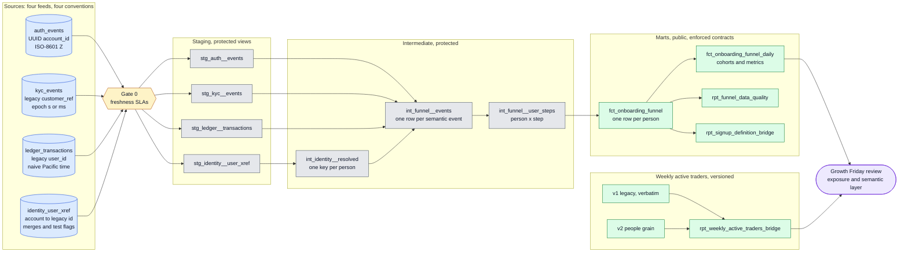
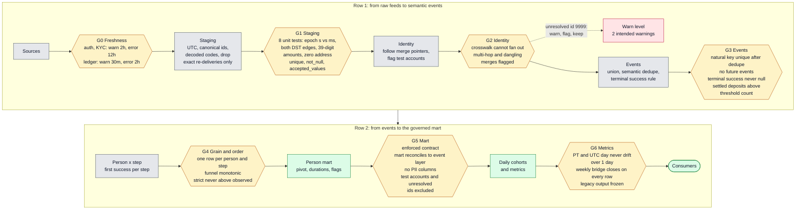
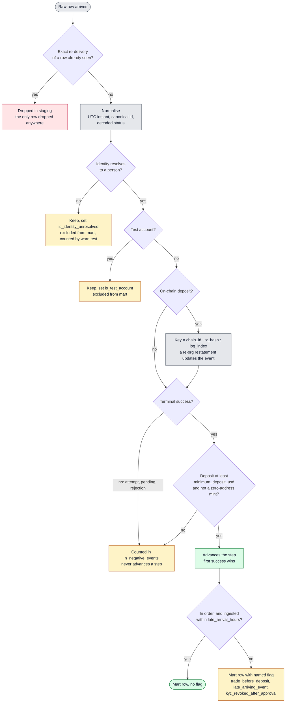
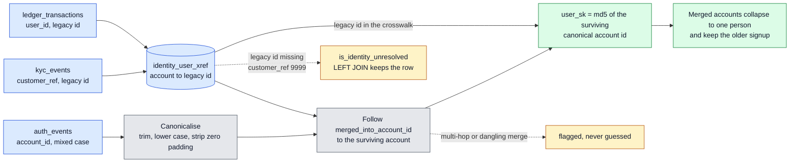
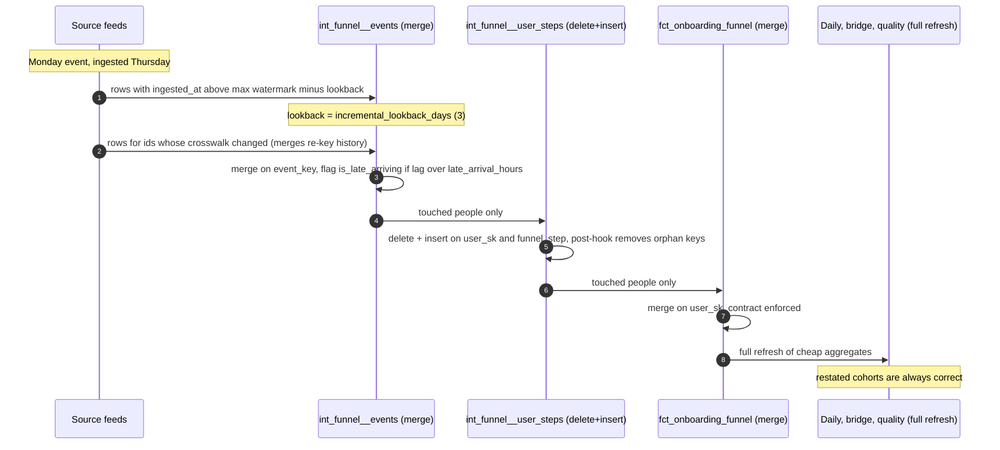
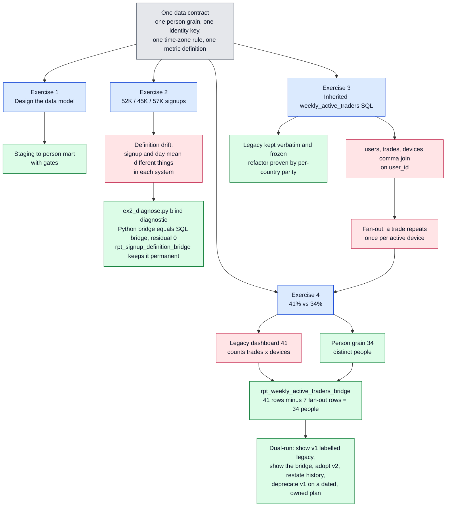
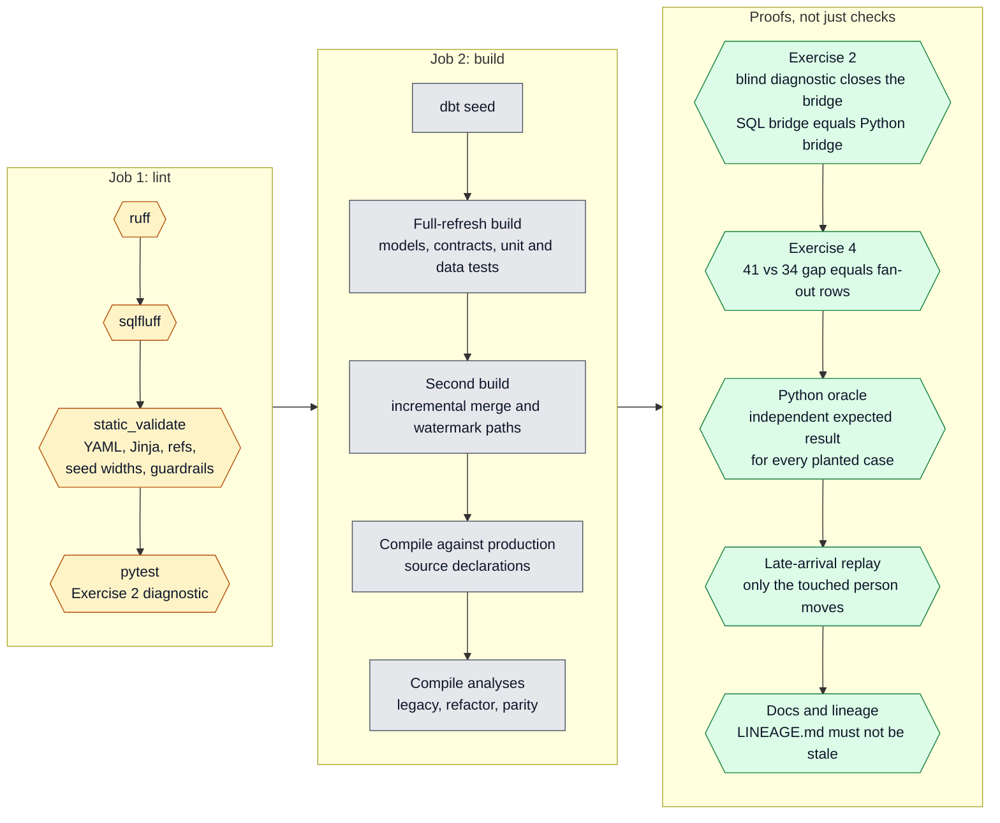
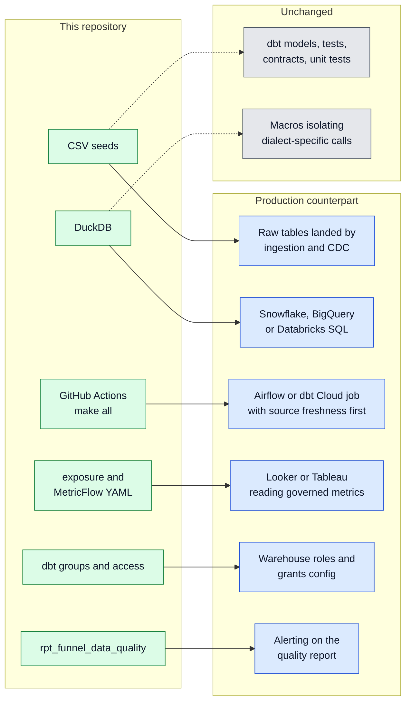

# Architecture

This page explains the pipeline in eight diagrams, from the outside in. Each one answers a single
question, so read them in order or jump to the one you need. GitHub renders the Mermaid blocks.
[`LINEAGE.md`](LINEAGE.md) is the model-level DAG generated from the dbt manifest; this page is the
hand-drawn explanation of why the DAG looks the way it does.

| # | Question | Diagram |
|---|---|---|
| 1 | What is the system, end to end? | [System overview](#1-system-overview) |
| 2 | Where does a bad row get stopped? | [Quality gates by layer](#2-quality-gates-by-layer) |
| 3 | What happens to one messy event? | [Life of an event](#3-life-of-an-event) |
| 4 | How does one person get one key? | [Identity resolution](#4-identity-resolution) |
| 5 | What happens when data arrives late? | [Incremental and late arrivals](#5-incremental-processing-and-late-arrivals) |
| 6 | How do the four exercises connect? | [Exercise map and the fan-out thread](#6-exercise-map-and-the-fan-out-thread) |
| 7 | What proves it works on every push? | [CI pipeline](#7-ci-pipeline) |
| 8 | How would it run in production? | [Production mapping](#8-production-mapping) |

Colour key used throughout: blue = source data, grey = staging and intermediate models, green =
public marts and reports, amber = a gate that can fail the build, rose = a planted problem or a
known risk.

---

## 1. System overview

Four feeds with four different identifier and timestamp conventions go in. One governed person-level
table and one metric layer come out. Everything between them is split so each layer has exactly one
job (rules in the [README layer table](../README.md#layer-rules)).

**Reading it.** The only door out of the intermediate layer is `fct_onboarding_funnel`, so nobody
can build a dashboard on a half-cleaned table. `protected` access is enforced by dbt groups, which
makes it a build error rather than a convention.

---

## 2. Quality gates by layer

A gate is a check that fails the build (or warns, where the input is known to be imperfect). Each
layer has its own gates, and a problem should be caught at the earliest layer that can see it. The
catalogue of planted problems and the test that catches each is in the
[README](../README.md#data-quality-planted-cases-and-the-tests-that-catch-them).

**Why a reconciliation gate and not only uniqueness.** `unique` proves a table has no duplicates; it
cannot prove the table did not silently lose people. G5 compares mart signups to the event layer,
which is the check that would have caught the bug that once dropped every fiat deposit.

---

## 3. Life of an event

This is the decision path one raw row takes. The principle is in
[ADR 0006](adr/0006-flags-not-filters.md): exclusions are flags in the intermediate layer and
filters only in the marts, so every excluded row stays countable.

---

## 4. Identity resolution

Each source names a person differently. The goal is a single `user_sk` that survives merges and is
identical on every rebuild in every warehouse ([ADR 0001](adr/0001-one-row-per-person.md)).

**Design choice.** Every join to identity is a `LEFT JOIN`. An inner join would turn a backlog in
the identity team into an apparent conversion drop in the funnel.

---

## 5. Incremental processing and late arrivals

The event tables are large and the person table is small. The pipeline therefore reads the large
tables once, incrementally, and rebuilds the small table only for people who changed
([ADR 0005](adr/0005-ingestion-time-watermark.md)). The watermark is **ingestion** time, so an
event that happened on Monday and arrives on Thursday is still inside Thursday's window.

`scripts/incremental_replay.py` proves this path rather than assuming it: it injects a Monday event
with a Thursday ingestion time, runs the ordinary incremental build, and asserts that exactly one
person's row moved and the cohort count rose by one.

---

## 6. Exercise map and the fan-out thread

The four exercises are one data-contract problem seen at four layers. Exercise 3 and Exercise 4 are
the same defect: a comma join from `trades` to `devices` repeats a trade once per active device.

**The thread.** Because Exercise 3 is the defect and Exercise 4 is its symptom, the bridge is
tested to close on every country (`bridge_closes`), and `assert_ex4_only_fanout_reproduces_41`
fails if anything other than the device fan-out is needed to reproduce 41%. The conversation with
the PM is in [`EXERCISE4_TALK_TRACK.md`](EXERCISE4_TALK_TRACK.md).

---

## 7. CI pipeline

Everything CI runs is reachable from `make all`. A cheap `lint` job gates a `build` job so that
style and structure failures never cost a full warehouse build.

---

## 8. Production mapping

The project runs on DuckDB so that anyone can build and test it in seconds with no credentials. The
model logic is warehouse-neutral by design: the time-zone, cast and epoch calls are isolated in macros, the
remaining dialect-specific constructs are listed below, and `use_seed_sources: false` already points staging at `source()` declarations. This
section maps each part to the tooling a large analytics team typically runs. The mapping is a plan,
not a claim: only the DuckDB path is executed in CI.

### Component mapping

| Concern | In this repository | Production counterpart | What changes |
|---|---|---|---|
| Raw data | `seeds/` CSVs with planted problems | Raw tables landed by ingestion or CDC | `--vars '{use_seed_sources: false}'`; the `source()` declarations and freshness SLAs already exist |
| Warehouse | DuckDB in process | Snowflake, BigQuery or Databricks SQL | New `profiles.yml` target plus the dialect swaps below |
| Orchestration | GitHub Actions running `make all` | Airflow or dbt Cloud job | Run `dbt source freshness` first, then `dbt build`; a stale feed stops the run |
| Pull request checks | Lint job then full build | Slim CI: `dbt build --select state:modified+ --defer --state <prod artifacts>` | Add a stored production manifest |
| Metrics and BI | `exposure` plus MetricFlow semantic model | Looker or Tableau reading the governed metrics | Point the BI tool at the daily mart; definitions stay in YAML |
| Access control | dbt groups and `access: protected` or `public` | Warehouse roles and dbt `grants:` config | Grant `select` on marts only; staging and intermediate stay private |
| Observability | `rpt_funnel_data_quality`, warn-level tests | Alert on freshness errors and on quality flag rates | Route test failures and report thresholds to the on-call channel |
| Documentation | `dbt docs generate` | Hosted dbt docs or a data catalog | Publish the manifest and catalog artifacts the CI job already uploads |
| Scale | Incremental merge with ingestion-time watermark | Same, plus partition or cluster keys | `ingested_at_utc` on the event table, `signup_date_pt` on the mart |

### Dialect swaps

These are the only places the SQL is not portable. Each is small and local.

| Construct (where) | DuckDB (here) | Snowflake | BigQuery |
|---|---|---|---|
| Time zone conversion (`macros/timezones.sql`) | `timezone('zone', ts)` | `convert_timezone('zone', ts)` | `datetime(ts, 'zone')` and `timestamp(dt, 'zone')` |
| Safe cast (`macros/safe_numeric.sql`) | `try_cast(x as t)` | `try_cast(x as t)` | `safe_cast(x as t)` |
| Epoch to timestamp (`epoch_mixed_to_utc`) | `to_timestamp(seconds)` | `to_timestamp(seconds)` | `timestamp_seconds(seconds)` |
| Conditional aggregate (26 uses of `count(*) filter (where ...)`) | `filter (where ...)` | `count_if(...)` or `sum(case ...)` | `countif(...)` |
| Day spine (`metricflow_time_spine.sql`) | `unnest(generate_series(...))` | `dbt.date_spine` or `generator` | `unnest(generate_date_array(...))` |
| Date difference | `date_diff('unit', a, b)` | `datediff(unit, a, b)` | `date_diff(b, a, unit)` (argument order differs) |
| Delimited string split | `string_split(s, '\|')` | `split(s, '\|')` | `split(s, '\|')` |
| 18-decimal amounts | `decimal(38,18)` | `number(38,18)` | `bignumeric`; `numeric` keeps only 9 decimals |
| `delete+insert` incremental (`int_funnel__user_steps`) | supported | supported | not supported; use `merge` or `insert_overwrite` on a date partition |
| Merge scan cost | full target scan | `incremental_predicates` on the lookback window | partition filter plus `incremental_predicates` |

To port, add the macro per column above (for example a `convert_tz` macro that dispatches on
`target.type`), then run the same `make all` against the new target. The unit tests and the Python
oracle are what make that safe: they fail if the new dialect changes a decoded value.
