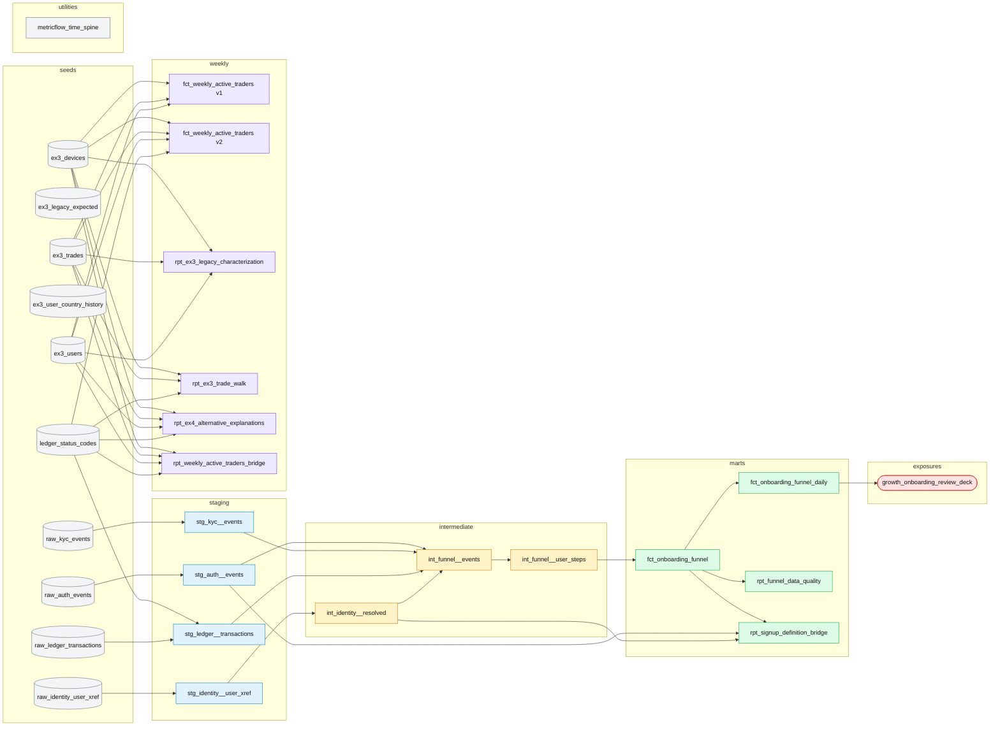

# Lineage

Generated from `target/manifest.json` by `scripts/render_lineage.py`. Seeds are cylinders, models are boxes, the exposure is a pill. Tests are omitted for legibility; `dbt ls --select +exposure:growth_onboarding_review_deck` lists everything the deck depends on.

